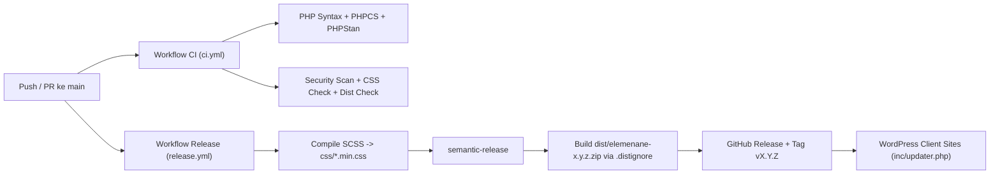

# Arsitektur CI/CD, Deployment, & Auto-Updater — Elemen Ane (`elemenane`)

## 1. Alur Pipeline CI/CD (GitHub Actions)

---

## 2. Continuous Integration (`.github/workflows/ci.yml`)
Berjalan otomatis pada setiap `push` dan `pull_request` ke branch `main` dan `develop`:
- Menguji kompatibilitas sintaks PHP pada matriks **PHP 8.0, 8.2, dan 8.3**.
- Menjalankan **PHPCS** (`composer lint:phpcs`) dengan standar `WordPress-Core`, `WordPress.Security`, dan `PHPCompatibilityWP`.
- Menjalankan **PHPStan Level 5** (`composer analyse`) dengan stub WordPress dan ACF Pro.
- Menjalankan **Security Scan** (`composer security:scan`), **CSS Audit** (`composer css:check`), dan **Dist Check** (`composer dist:check`).

---

## 3. Otomatisasi Rilis (`.github/workflows/release.yml` & `.releaserc.json`)
Setiap commit yang masuk ke branch `main` dianalisis oleh **semantic-release**:
1. Menganalisis pesan commit berdasarkan **Conventional Commits** (`feat:`, `fix:`, `perf:`).
2. Menentukan versi semantik berikutnya (`nextRelease.version`).
3. Memperbarui `CHANGELOG.md` dan baris `Version:` pada `style.css`.
4. Mengompilasi ulang seluruh SCSS (`scss/[!_]*.scss` → `css/*.min.css`).
5. Menjalankan `bash bin/check-dist.sh` dan memaketkan file produksi menggunakan `rsync -rc --exclude-from=.distignore` ke dalam arsip `elemenane-${version}.zip`.
6. Mempublikasikan GitHub Release beserta aset `elemenane-${version}.zip`.

---

## 4. Mekanisme Auto-Updater di Situs Klien (`inc/updater.php`)
Modul `inc/updater.php` menghubungkan dashboard WordPress klien ke GitHub Releases (`webaneid/elemenane`):
- Memeriksa rilis terbaru melalui GitHub API (`/repos/webaneid/elemenane/releases/latest`) dan menyimpan respons di transient `elemenane_github_release` selama 6 jam.
- Mengutamakan aset `.zip` yang diunggah pada GitHub Release (`assets[0]->browser_download_url`) daripada `zipball_url` mentah, sehingga folder saat diekstrak sudah bernama `elemenane/` dan bebas dari file dev.
- Memiliki fallback `upgrader_source_selection` untuk memastikan nama direktori hasil ekstraksi selalu sesuai dengan slug tema aktif (`elemenane`).
- Mendukung **repositori privat** maupun batas rate-limit tinggi melalui token GitHub yang dikonfigurasi via konstanta `ELEMENANE_UPDATER_TOKEN` di `wp-config.php` atau opsi `ane_updater_token`.
