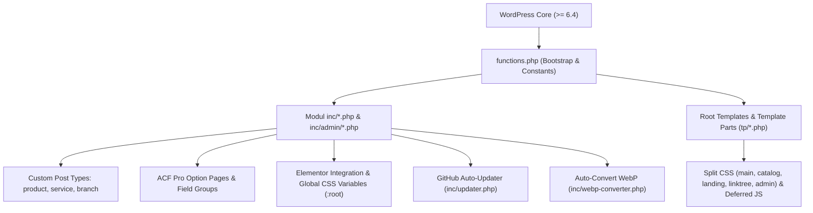

# Arsitektur Umum — Elemen Ane (`elemenane`)

## 1. Gambaran Umum Arsitektur
**Elemen Ane** (`elemenane`) adalah tema WordPress hybrid buatan Webane Indonesia yang menggabungkan sistem template klasik WordPress (portal berita, majalah, katalog produk, direktori cabang, dan halaman Linktree) dengan integrasi mendalam ke **Elementor** dan **Advanced Custom Fields (ACF) Pro**.



---

## 2. Struktur Direktori Utama
```text
elemenane/
├── style.css                  # Header metadata tema (versi, lisensi, tags)
├── functions.php              # Bootstrap tema, theme supports, menu, image sizes, & require_once modul
├── header.php / footer.php    # Wrapper header & footer (mendukung Elementor Theme Builder + fallback tp/*-asli.php)
├── page-home.php              # Template Landing Page (memisahkan tampilan desktop & mobile via ane_is_mobile())
├── page-linktree.php          # Template Bio Link / Linktree dengan analitik klik
├── single-product.php         # Template detail produk (kompatibel meta WooCommerce)
├── archive-product.php        # Template katalog produk dengan AJAX filter
├── single-branch.php          # Template detail cabang dengan Google Maps & petunjuk arah
├── archive-branch.php         # Template direktori cabang dengan peta interaktif multi-marker
├── inc/                       # Modul fungsional PHP
│   ├── elemenane.php          # Fungsi inti tema, enqueue aset, helper gambar, related posts, schema
│   ├── acf.php                # Registrasi ACF Option Pages & konfigurasi Google Maps API key
│   ├── custompost.php         # Registrasi CPT (product, service, branch) & taxonomy (product_cat, product_tag)
│   ├── feature-toggles.php    # Toggle fitur CPT via ACF Option Page
│   ├── elementor.php          # Integrasi Elementor & injeksi CSS Custom Properties (:root)
│   ├── product-acf.php        # Field group ACF produk (sinkron dengan meta key WooCommerce)
│   ├── product-filter.php     # Handler AJAX filter & pencarian produk
│   ├── branch-acf.php         # Field group ACF cabang/lokasi & koordinat peta
│   ├── seo.php                # Meta tags SEO, OpenGraph, Twitter Card, Schema JSON-LD, XML Sitemap
│   ├── tracking-scripts.php   # Injeksi Google Analytics, Search Console, & Meta Pixel
│   ├── updater.php            # GitHub Release auto-updater (mendukung repositori publik & privat)
│   ├── webp-converter.php     # Konversi otomatis upload JPG/PNG ke WebP (Fase 04)
│   ├── icons.php              # Helper Inline SVG elemenane_icon() pengganti FontAne (Fase 05)
│   └── admin/                 # Modul kustomisasi wp-admin, dashboard analytics, & Linktree analytics
├── tp/                        # Template parts untuk layout berita, kartu artikel, produk, header/footer asli
├── scss/                      # Sumber SCSS modular (5 entrypoint + 34 partial)
├── css/                       # File CSS hasil kompilasi (.css & .min.css)
├── js/                        # Script frontend & admin (OwlCarousel, Magnific Popup, product filter, branch map)
└── languages/                 # File lokalisasi (.po / .mo) dengan text domain 'elemenane'
```

---

## 3. Kontrak Database & Kompatibilitas (Wajib Dijaga)

### 3.1. Custom Post Types & Taxonomies
| Jenis | Slug | Deskripsi |
| :--- | :--- | :--- |
| CPT | `product` | Katalog produk dengan dukungan galeri, harga, diskon, SKU, stok, dan marketplace links |
| CPT | `service` | Layanan perusahaan |
| CPT | `branch` | Lokasi kantor/cabang dengan koordinat Google Maps & jam operasional |
| Taxonomy | `product_cat` | Kategori produk (hierarchical, rewrite slug `product-category`) |
| Taxonomy | `product_tag` | Tag produk (non-hierarchical, rewrite slug `product-tag`) |

### 3.2. Kontrak Meta Key Produk (WooCommerce-Compatible)
Modul `inc/product-acf.php` dan `inc/product-filter.php` menyimpan data langsung pada meta key standar WooCommerce agar klien dapat bermigrasi ke WooCommerce penuh kapan saja tanpa kehilangan data:
- `_regular_price`, `_sale_price`, `_price` (harga aktif/efektif untuk sorting & filter)
- `_sku`, `_stock`, `_stock_status` (`instock`, `outofstock`, `onbackorder`), `_manage_stock`
- `_product_image_gallery`

### 3.3. ACF Option Pages
| Menu Title | Menu Slug | Kegunaan |
| :--- | :--- | :--- |
| ElemenAne Setup | `ane-setup` | Induk menu pengaturan tema |
| General Setting | `ane-general-setting` | Identitas perusahaan, alamat, kontak, warna/desain, script pelacakan, & fitur aktif |
| Customer Care | `ane-customer-care` | Daftar nomor WhatsApp CS, floating chat button, & jam layanan |
| News & SEO | `ane-seo-news` | Pengaturan SEO berita, Google News, & iklan banner |

### 3.4. Tabel Database Kustom
- `{$wpdb->prefix}ane_linktree_clicks`: Menyimpan analitik klik tombol pada halaman Linktree (`inc/admin/linktree-analytics.php`).
